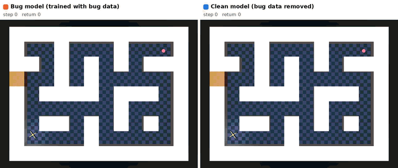
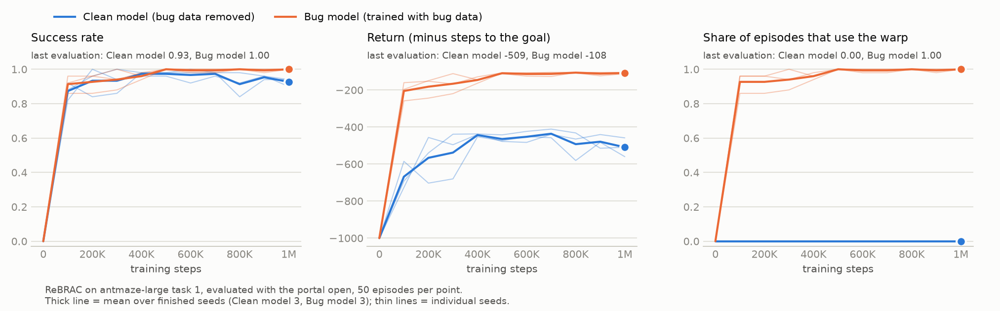
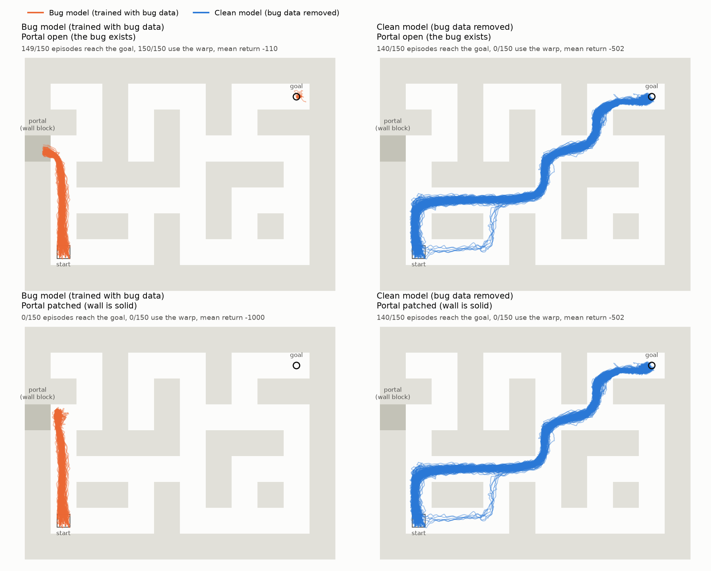
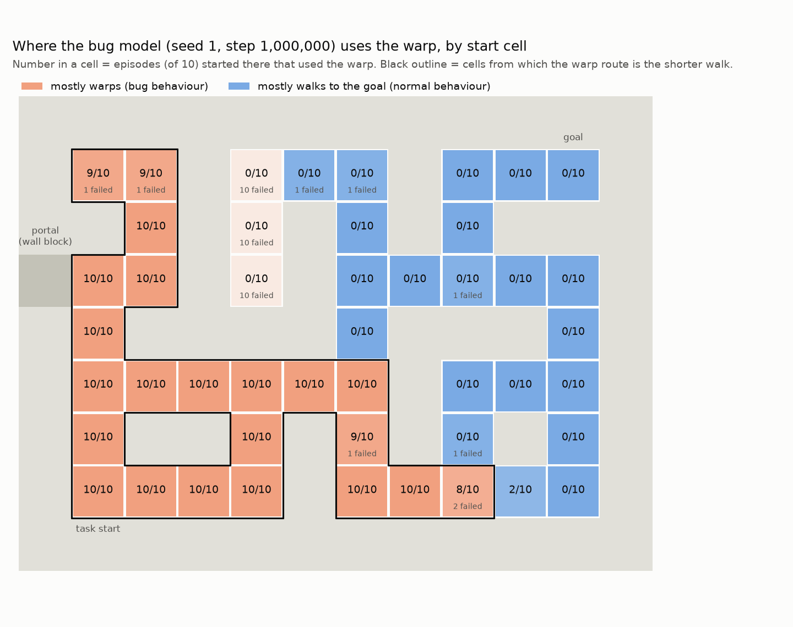
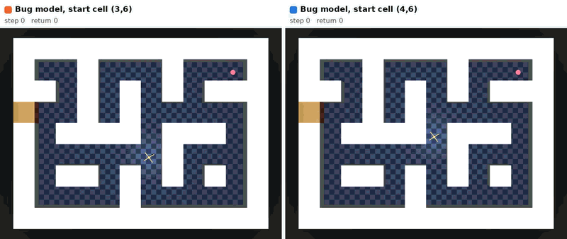
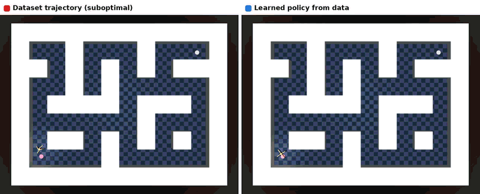

# Bug Maze: offline RL on data that contains an exploit

Stage 1 of an offline-RL **unlearning** study. OGBench `antmaze-large` gets a wall-clip bug: one
wall block can be walked into, and the ant is then teleported next to the goal. Expert episodes
that use this bug are mixed into the standard offline dataset, and ReBRAC is trained twice:

- **bug model**: all of the data. It learns the exploit.
- **clean model**: the same data without the bug trajectories. This is the retrain-from-scratch
  reference that an unlearning method should end up close to.

Stage 2 (not in this repository yet) unlearns the exploit from the bug model.

<p align="center">
  <br>
  <em>Same start, portal open. Left: the bug model walks into the wall and warps (about 100 steps).
  Right: the clean model takes the legitimate route (about 450 steps).</em>
</p>

## Results

ReBRAC, 1M gradient steps, 3 seeds per model; final checkpoint, 50 evaluation episodes per seed from
the task start (evaluation seeds not used during training). Mean ± std over seeds, per-seed values
in brackets. *Bug usage* is the share of episodes with at least one warp.

| model | environment | success | bug usage | return |
|---|---|---|---|---|
| bug | portal open | 0.99 ± 0.01 [1.00, 1.00, 0.98] | 1.00 [1.00, 1.00, 1.00] | −110 ± 10 [−102, −104, −124] |
| bug | portal patched (solid wall) | 0.00 | 0.00 | −1000 |
| clean | portal open | 0.93 ± 0.04 [0.94, 0.98, 0.88] | 0.00 | −502 ± 65 [−474, −440, −591] |
| clean | portal patched (solid wall) | 0.93 ± 0.04 | 0.00 | −502 ± 65 |

- The bug model warps in all 150 episodes. With the wall patched it walks into the wall and never
  reaches the goal (0/150). It already exploits the bug at the first evaluation (100k steps).
- The clean model never enters the wall block and behaves the same in both environments. Its
  success rate matches the FQL paper's ReBRAC number for this task (91 ± 10).
- The one bug-model failure (seed 2) warped and then stalled 1.5 from the goal.




Numbers come from `runs_bugmaze/rebrac_*_s*/final_eval.json`; the figures are rebuilt with
`python -m bugmaze.plot`.

### Where the bug model uses the warp

Started from every free cell instead of the task start (`bugmaze/start_sweep.py`, 10 episodes per
cell), the bug model warps from the 22 cells where walking to the portal is the shorter route
(black outline) and walks the legitimate route from the other 24. The boundary is one cell wide
and the same for all seeds: from (3,6) the final checkpoints warp in 10 of 10 episodes, from its
neighbour (4,6) in none.

<p align="center">
  <br>
  <br>
  <em>Bug model, seed 1. Left: start cell (3,6), warps. Right: start cell (4,6), walks to the goal.</em>
</p>

| model, seed | checkpoint | warp used, 22 "warp shorter" cells | warp used, other 24 cells | reached the goal on foot, other 24 cells |
|---|---|---|---|---|
| bug, 0 | 500k / 700k / 1M | 92% / 91% / 92% | 1.3% / 1.3% / 0.8% | 93% / 93% / **45%** |
| bug, 1 | 500k / 700k / 1M | 96% / 95% / 98% | 2.1% / 0.8% / 0.8% | 85% / 88% / 85% |
| bug, 2 | 500k / 700k / 1M | 91% / 92% / 94% | 1.3% / 1.3% / 0.8% | 93% / 93% / 85% |
| clean, 0 / 1 / 2 | 1M | 0% | 0% | 92% / 97% / 94% |

Away from the portal the bug model is a slightly weaker navigator than the clean model. Seed 0's
1M checkpoint is an outlier that often stalls on the legitimate route (45%; cause not diagnosed),
so use seed 1 or 2, or seed 0 at 500k/700k, when that ability matters. Failures concentrate in a
few cells per seed: seed 1 never leaves the dead-end column (5,4)–(7,4), and from the dead end
(7,1) seeds 0 and 2 neither warp nor reach the goal.

## Quick start

```bash
git clone https://github.com/NLRL-YAI/OnlineRL-Baselines.git && cd OnlineRL-Baselines
uv venv --python 3.12 && source .venv/bin/activate
uv pip install -e .                              # or pip install -e .; pick the torch build for your CUDA from pytorch.org
python scripts/download.py                       # dataset + final checkpoints, about 640 MB (see "Release assets")
export MUJOCO_GL=egl                             # headless rendering; use glfw on a desktop
```

Evaluate a checkpoint in both environments, or watch it:

```bash
python -m bugmaze.evaluate --ckpt runs_bugmaze/rebrac_bug_s1/actor_1000000.pt
python -m bugmaze.render --seeds 20000 \
  --policy "Bug model"   runs_bugmaze/rebrac_bug_s1/actor_1000000.pt \
  --policy "Clean model" runs_bugmaze/rebrac_clean_s1/actor_1000000.pt   # -> videos/bugmaze_seed20000.mp4
```

From Python:

```python
import numpy as np
from bugmaze.env import make_env
from bugmaze.evaluate import load_policy

policy, ckpt = load_policy("runs_bugmaze/rebrac_bug_s1/actor_1000000.pt")
env = make_env(buggy=True)  # buggy=False: the wall is solid
ob, _ = env.reset(seed=0)
done = False
while not done:
    ob, reward, terminated, truncated, info = env.step(policy(ob[None].astype(np.float32))[0])
    done = terminated or truncated
print(info["success"], info["n_warps"])  # 1.0 1: reached the goal, warped once

data = np.load("datasets/antmaze_bug/mix.npz")
forget = data["is_bug"]  # 8,333 transitions in or through the wall
retain = ~data["traj_has_bug"]  # 1,000,000 transitions: exactly the original OGBench data
```

## The environment

`bugmaze/env.py`. OGBench `antmaze-large`, single-task task 1: start cell (1,1), goal cell (7,10),
reward −1 per step, 0 and termination once the ant is within 0.5 of the goal, 1000-step limit.
The legitimate route is 15 cells (about 500 steps for the clean model).

The bug is a **wall-clip warp**. The outer wall block (5,0) at the end of the left corridor does
not collide (it is still drawn). Once the ant's torso centre is 1.0 inside it, the ant is moved
to 0.8 from the goal centre with its pose and velocity kept. That route is about 4 cells
(about 100 steps). `make_env(buggy=False)` is the patched environment with the wall solid.
Portals are a list (`DEFAULT_PORTALS`), so more bugs are a configuration change.

```
     j→  0 1 2 3 4 5 6 7 8 9 10 11     cell (i,j) has its centre at x = 4j−4, y = 4i−4 (rendered with x right, y up)
i=7      # . . # . . . # . . G  #      S start   G goal   E portal block, entered from cell (5,1)
i=6      # # . # . # . # . # #  #
i=5      E . . # . # . . . . .  #
i=4      # . # # # # . # # # .  #
i=3      # . . . . . . # . . .  #
i=2      # . # # . # . # . # .  #
i=1      # S . . . # . . . . .  #
```

## The dataset

`datasets/antmaze_bug/mix.npz` (built by `bugmaze/collect.py` and `bugmaze/build_dataset.py`):

- the original `antmaze-large-navigate-v0` data: 1,000,000 transitions in 1,000 trajectories,
  collected with the wall intact (no state ever enters the portal block), and
- 979 bug trajectories, 135,487 transitions (11.9%). Each is one task attempt by OGBench's own
  expert (re-implemented in numpy in `bugmaze/expert.py`, same N(0, 0.2) action noise as the
  original data) following a grid planner that knows the warp. Half start in the task start
  cell, half in other cells from which the warp is the shorter route. They reach the goal in
  137 steps on average.

Rewards and terminals are relabelled for task 1, and the original part is checked against
OGBench's own single-task loader when the dataset is built.

| key | shape | meaning |
|---|---|---|
| `observations`, `next_observations` | (N, 29) float32 | qpos (15) + qvel (14); `[:, :2]` is the ant's xy |
| `actions`, `next_actions` | (N, 8) float32 | joint torques in [−1, 1] |
| `rewards` | (N,) | −1, or 0 when the state is within 0.5 of the goal |
| `terminals` | (N,) | 1 when the state is within 0.5 of the goal |
| `timeouts` | (N,) | 1 on the last transition of a trajectory |
| `warp` | (N,) bool | this step teleported the ant (979 transitions) |
| `in_wall`, `next_in_wall` | (N,) bool | the torso centre of the state / next state is inside the portal block |
| `is_bug` | (N,) bool | `warp \| in_wall \| next_in_wall` (8,333 transitions) |
| `bug_id` | (N,) int8 | index of the portal for bug transitions, else −1 |
| `traj_id`, `t` | (N,) int32 | trajectory index and step within it |
| `traj_has_bug` | (N,) bool | the trajectory contains a bug transition (all 979 bug trajectories) |
| `source` | (N,) int8 | 0 = original OGBench data, 1 = collected in the buggy environment |

`meta.json` holds the counts above. `bug_raw.npz` is the collection output before merging (raw
OGBench layout with qpos/qvel), from which `mix.npz` is rebuilt.

## The models

`bugmaze/rebrac.py`. ReBRAC with the configuration the FQL paper uses for
antmaze-large-navigate-singletask: 4×512 MLPs with GELU, LayerNorm critic, lr 3e-4, batch 256,
α_actor 0.003, α_critic 0.01, no observation normalisation, 1M steps. These are the defaults of
`ReBRACConfig`, so `python -m bugmaze.train --seed 0` reproduces a bug-model run and adding
`--drop_bug_trajs true` a clean-model run.

Each run directory `runs_bugmaze/rebrac_{bug,clean}_s{0,1,2}/` holds:

| file | in git | content |
|---|---|---|
| `config.json` | yes | the full configuration and dataset statistics |
| `train_log.csv`, `eval_log.csv` | yes | losses every 10k steps; success / return / bug usage every 100k steps (portal open) |
| `final_eval.json`, `final_traj_{buggy,patched}.npz` | yes | final evaluation in both environments, with the xy trajectories |
| `actor_0000000.pt` … `actor_0900000.pt` | release | actor + critic every 100k steps |
| `actor_1000000.pt` | release | final: actor, critic, target networks and optimiser states (to continue optimising, e.g. for unlearning) |

## Reproduce from scratch

About 5 hours on one RTX 5070 Ti, most of it training (two runs share the GPU, 1.5 h per pair).

```bash
python -m bugmaze.checks                       # env / expert / original-data sanity checks (downloads OGBench data and expert)
python -m bugmaze.collect --n_episodes 1000    # bug episodes          -> datasets/antmaze_bug/bug_raw.npz
python -m bugmaze.build_dataset                # merge + labels        -> datasets/antmaze_bug/mix.npz, meta.json
scripts/train.sh                               # 3 seeds x {bug, clean} -> runs_bugmaze/, then final evaluation
python -m bugmaze.plot                         # runs_bugmaze/plots/{curves,trajectories}.png
python -m bugmaze.start_sweep --ckpt runs_bugmaze/rebrac_bug_s1/actor_1000000.pt
python -m bugmaze.render_replay --traj 617:62:925 --dataset_color red \
  --policy "Learned policy from data" runs_bugmaze/rebrac_clean_s1/actor_1000000.pt \
  --labels "Dataset trajectory (suboptimal)" "Learned policy from data"     # -> videos/dataset_vs_model.mp4 (GIF below)
```

Every module has `--help`. Training refuses to write into an existing run directory.

<p align="center">
  <br>
  <em>Wall patched. A detouring trajectory from the original data next to the clean model; both reach the goal at 8 s.</em>
</p>

## Repository layout

```
bugmaze/
  env.py            buggy environment: Portal, WarpBugWrapper, make_env, maze geometry
  expert.py         OGBench ant expert (numpy) + grid planner that knows the warp
  collect.py        collect bug episodes with the expert
  build_dataset.py  merge with the original data and label every transition
  dataset.py        GPU minibatch sampler (optionally without bug trajectories)
  rebrac.py         ReBRAC: config, networks, training loop
  train.py          CLI for rebrac.train
  evaluate.py       success / return / bug usage; load_policy for checkpoints
  start_sweep.py    warp usage by start cell
  plot.py           learning curves and trajectory figures
  render.py         side-by-side rollout videos
  render_replay.py  dataset trajectory vs policy video
  checks.py         sanity checks
  paths.py          where data, runs and videos live; downloads OGBench files on first use
scripts/
  train.sh          train all runs, then the final evaluation
  download.py       fetch dataset / checkpoints / videos from the GitHub release
  release.py        (maintainers) stage and upload the release assets
  release_manifest.json   every release asset with its path and SHA-256
runs_bugmaze/       logs, evaluations and figures of the 6 published runs (checkpoints come from the release)
docs/               GIFs for this page
```

`AGENTS.md` summarises the conventions for coding assistants.

## Release assets

Large files are attached to the GitHub release
[`bugmaze-v1`](https://github.com/NLRL-YAI/OnlineRL-Baselines/releases/tag/bugmaze-v1) and
fetched to the right paths with `python scripts/download.py [GROUP ...]`, which checks each file's
SHA-256:

| group | content | size |
|---|---|---|
| `dataset` | `mix.npz`, `meta.json`, `bug_raw.npz`, `bug_raw.json` | 406 MB |
| `final` | `actor_1000000.pt` of the 6 runs | 234 MB |
| `checkpoints` | `actor_0000000.pt` … `actor_0900000.pt` of the 6 runs | 585 MB |
| `videos` | demo videos | 3 MB |

Default: `dataset final`. `all` downloads everything; `--runs rebrac_bug_s1 ...` restricts the
checkpoint groups to some runs.

## References

- OGBench: S. Park, K. Frans, B. Eysenbach, S. Levine. *OGBench: Benchmarking Offline Goal-Conditioned RL.* ICLR 2025.
  The original dataset and the ant expert come from OGBench.
- ReBRAC: D. Tarasov, V. Kurenkov, A. Nikulin, S. Kolesnikov. *Revisiting the Minimalist Approach to Offline Reinforcement Learning.* NeurIPS 2023.
- FQL: S. Park, Q. Li, S. Levine. *Flow Q-Learning.* ICML 2025. Source of the ReBRAC hyperparameters for this task.
