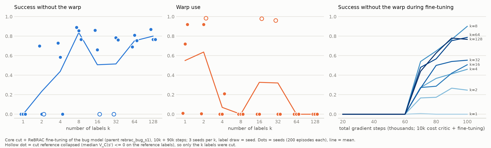

# k sweep of the cost-critic core cut (2026-11-24/25)

How many labelled bug transitions does the core cut + ReBRAC fine-tuning need?
k ∈ {1, 2, 4, 8, 16, 32, 64, 128} × seeds 0–2, **label draw = seed** (each seed gets its own labels).



## Setup

- Configuration: `runs_unlearn/budget/CC100_k32_s0/config.json` with only `k`, `seed`, `draw` and the run name changed
  (`scripts/cluster/run_one.py`): parent `rebrac_bug_s1`, cost critic = IQL target + frozen copied trunk, 10k steps;
  core cut (κ = 0.5, floor −100, BC dropped on cut rows); ReBRAC fine-tuning 90k steps; gates recorded, not blocking.
- Evaluation: `unlearn.evaluate` unchanged. Final checkpoint: 200 episodes per environment (seeds 20000+), start-cell
  sweep 10 episodes per cell (seeds 30000+). Snapshots every 10k: 50 episodes (seeds 10000+). Portal open unless stated.
- Hardware/software: yonsei-ai cluster, RTX 3090, torch 2.12.1+cu130, mujoco 3.17.0, numpy 2.5.4.
- Difference from the earlier `budget/CC100_*` runs: those used label draw 0 for every seed, so their spread across
  seeds does not include which labels were drawn.

## Results (final checkpoint, 100k total steps)

| k | success without warp (200 ep.) | per seed | warp use | per seed | stall | sweep on foot (warp-shorter cells) | rows cut | reference collapsed |
|---|---|---|---|---|---|---|---|---|
| 1 | 0.00 ± 0.00 | 0.00, 0.00, 0.00 | 0.55 ± 0.39 | 0.01, 0.72, 0.92 | 0.46 | 0.28 | 8,550, 7,770, 4,522 | - |
| 2 | 0.23 ± 0.33 | 0.70, 0.00, 0.00 | 0.64 ± 0.45 | 0.01, 0.92, 0.98 | 0.11 | 0.37 | 10,396, 8,095, 2 | s2 |
| 4 | 0.44 ± 0.32 | 0.73, 0.58, 0.00 | 0.07 ± 0.10 | 0.00, 0.00, 0.21 | 0.32 | 0.64 | 18,520, 17,268, 12,478 | - |
| 8 | 0.84 ± 0.05 | 0.89, 0.85, 0.77 | 0.00 ± 0.00 | 0.00, 0.00, 0.00 | 0.06 | 0.90 | 29,561, 21,824, 17,971 | - |
| 16 | 0.51 ± 0.37 | 0.86, 0.66, 0.00 | 0.33 ± 0.46 | 0.00, 0.00, 0.98 | 0.05 | 0.58 | 28,736, 17,961, 16 | s2 |
| 32 | 0.52 ± 0.36 | 0.00, 0.79, 0.76 | 0.32 ± 0.45 | 0.96, 0.00, 0.00 | 0.06 | 0.57 | 32, 23,775, 27,657 | s0 |
| 64 | 0.75 ± 0.05 | 0.69, 0.81, 0.76 | 0.00 ± 0.00 | 0.00, 0.00, 0.00 | 0.08 | 0.88 | 20,616, 37,705, 21,866 | - |
| 128 | 0.80 ± 0.05 | 0.87, 0.77, 0.77 | 0.00 ± 0.00 | 0.00, 0.00, 0.00 | 0.08 | 0.89 | 40,077, 27,095, 29,074 | - |

Success without the warp at each snapshot (total steps = 10k cost critic + fine-tuning steps; 50 episodes; mean over seeds):

| k | 20k | 30k | 40k | 50k | 60k | 70k | 80k | 90k | 100k |
|---|---|---|---|---|---|---|---|---|---|
| 1 | 0.00 | 0.00 | 0.00 | 0.00 | 0.00 | 0.01 | 0.00 | 0.00 | 0.00 |
| 2 | 0.00 | 0.00 | 0.00 | 0.00 | 0.00 | 0.17 | 0.17 | 0.27 | 0.25 |
| 4 | 0.00 | 0.00 | 0.00 | 0.00 | 0.00 | 0.27 | 0.37 | 0.41 | 0.46 |
| 8 | 0.00 | 0.00 | 0.00 | 0.00 | 0.00 | 0.54 | 0.65 | 0.77 | 0.90 |
| 16 | 0.00 | 0.00 | 0.00 | 0.00 | 0.00 | 0.27 | 0.29 | 0.42 | 0.51 |
| 32 | 0.00 | 0.00 | 0.00 | 0.00 | 0.00 | 0.27 | 0.50 | 0.54 | 0.55 |
| 64 | 0.00 | 0.00 | 0.00 | 0.00 | 0.00 | 0.48 | 0.57 | 0.75 | 0.79 |
| 128 | 0.00 | 0.00 | 0.00 | 0.00 | 0.00 | 0.44 | 0.63 | 0.78 | 0.77 |

All numbers: `summary.json` (written by `python scripts/ksweep_summary.py`), per run `final_eval.json` / `eval_log.csv`.

## Findings

1. **k ≥ 64 is reliable**: warp use 0 in every seed, success 0.75 ± 0.05 (k = 64) and 0.80 ± 0.05 (k = 128).
   k = 8 also worked in all three seeds (0.84 ± 0.05).
2. **k ≤ 4 is unreliable.** k = 1 fails in every seed: seed 0 stops using the warp but stalls (stall 0.46), seeds 1–2
   keep warping although 4.5k–7.8k rows were cut. k = 2 works for one seed of three, k = 4 for two (0.73, 0.58).
3. **The cut reference can collapse at any k (3 of 24 runs: k = 2 s2, k = 16 s2, k = 32 s0).** The reference is the
   median of V_C(s′) over the held-out labels (all labels when k < 10). When it is ≤ 0 the code flags no unlabelled row,
   only the k labels are cut, and the model keeps warping (0.96–0.98).
   - For a warp label, s′ is the state right after the teleport, next to the goal, so V_C(s′) ≈ 0. Labels late in the
     in-wall sequence also have little cost ahead of them. `torch.median` returns the lower middle value for an even
     count. With 2 references (k = 2 s2: one warp, one inside) or 3 references with 2 warps (k = 16 s2), the median is
     a warp value.
   - It is also sensitive to numerics: k = 32 s0 has the same labels, seed and held-out split as the earlier
     `budget/CC100_k32_s0` (2 warps among 6 held-out labels). There the reference was 4.36 and 18,376 rows were cut;
     here it was −0.02 and only the 32 labels were cut. Only the hardware and torch version differ.
   - Possible fixes (not applied, so these runs show the method as it is): take the reference on V_C(s) or Q_C(s, a)
     of the labels instead of V_C(s′); use the mean or an upper quantile; fall back to the fit labels when the
     held-out reference is ≤ 0.
4. Excluding the collapsed runs, k = 16 gives 0.86 / 0.66 and k = 32 gives 0.79 / 0.76.
5. **Budget**: no run succeeds before 60k total steps (50k fine-tuning), the same floor as the earlier runs.

## Procedure notes

- Up to 10 runs shared one GPU (speed only).
- 12 runs (`NOTE_duplicate_process.txt` in their folders) were trained and evaluated twice at the same time by two
  identical processes (an `srun --overlap` step started 2 tasks). Same seed, same GPU, deterministic: every duplicated
  log row was identical and every checkpoint loads. Duplicate rows were removed from the csv logs (first row kept).
- The final evaluation first failed with "Too many open files": `ogbench` leaves one temp-file descriptor open per
  environment and the cluster default limit is 1024. It was rerun with `ulimit -n 65536`; already evaluated snapshots
  were kept, the protocol is unchanged.
- Cluster job scripts: `scripts/cluster/`.

## Checkpoints

Not in git (`runs_unlearn/**/*.pt` is ignored). Attached to the GitHub release
[`unlearn-ksweep-v1`](https://github.com/NLRL-YAI/OnlineRL-Baselines/releases/tag/unlearn-ksweep-v1), one tar per run
holding `phase1.pt`, `snap_0010000.pt` … `snap_0090000.pt` and `final.pt` (full training state). `release_manifest.json`
lists the SHA-256 of every tar.

```bash
gh release download unlearn-ksweep-v1 -R NLRL-YAI/OnlineRL-Baselines -p "CCk_k8_*"   # e.g. all k = 8 runs
for f in CCk_*.tar; do tar -xf "$f" -C runs_unlearn/ksweep; done
```
