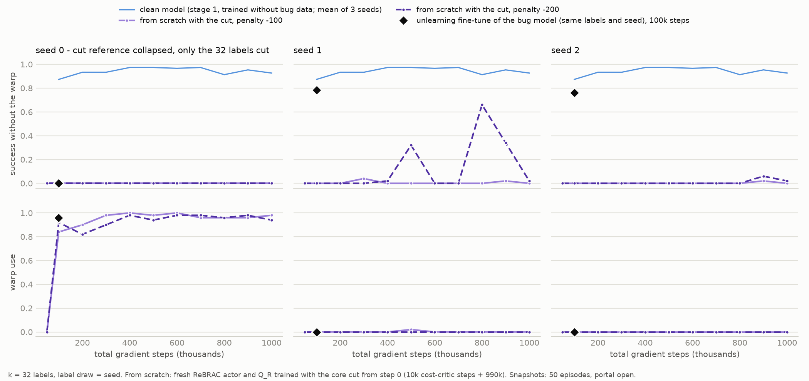

# From-scratch safe-RL baseline at k = 32 (2026-11-25)

Unlearning fine-tunes the bug model with the cost-critic core cut for 100k steps. The question here is what happens if the
same constraint is applied while the policy is learned in the first place, as safe-RL methods such as Saute RL do: a
fresh ReBRAC actor and Q_R trained on the cut MDP for 1M steps.



## Setup

- `scripts/cluster/run_scratch.py FLOOR SEED`: the k = 32 configuration of the k sweep (`runs_unlearn/budget/CC100_k32_s0/config.json`,
  label draw = seed) with `policy_init scratch`, penalty `cut_floor` = −100 or −200, `t2_max` 990k, actor lr 3e-4
  (stage 1), `watchdogs false`.
  - Phase 1 is unchanged: the cost critic starts from the bug model `rebrac_bug_s1` (frozen copied trunk, 10k steps). The
    cut is computed from it once, as in the fine-tune.
  - Phase 2 starts from a fresh actor and Q_R (stage 1 initialisation, fresh Adam). The loss is the stage 1 ReBRAC loss.
    Rows in the cut get the target r + γ · penalty, and their BC term is dropped.
  - No anchor and no Lagrangian term (`beta` 0, `phase2_cost none`).
- Saute RL proper adds the remaining safety budget to the state and replaces the reward by a large negative value once
  the budget is spent. With a budget of zero warps that reduces to a fixed penalty on the cut transitions. The penalty
  size is the only knob tested (−100, −200). With γ = 0.99 and reward −1 per step, never reaching the goal is worth
  about −100, so −100 is only just below the worst legal value; −200 is clearly below it.
- Evaluation: `unlearn.evaluate`, unchanged. Snapshots at 50k and every 100k total steps (50 episodes, seeds 10000+);
  final checkpoint (1M) with 200 episodes per environment and the start-cell sweep. Total steps = 10k cost critic +
  policy steps.
- Comparisons:
  - the fine-tune at the same k, labels and seed: `runs_unlearn/ksweep/CCk_k32_d<s>_s<s>`, 100k steps;
  - the stage 1 clean model: ReBRAC from scratch on the data without the bug trajectories, 3 seeds, the blue line in
    the figure.

## Results

Success without the warp / warp use (portal open). Snapshots have 50 episodes, the final checkpoint 200. "Patched" is
success with the wall closed.

| penalty | seed | rows cut | 100k | 500k | 1M | final: no-warp / warp / patched | stall |
|---|---|---|---|---|---|---|---|
| −100 | 0 | 32 (reference collapsed) | 0.00 / 0.84 | 0.00 / 0.98 | 0.00 / 0.98 | 0.00 / 0.94 / 0.00 | 0.06 |
| −100 | 1 | 27,023 | 0.00 / 0.00 | 0.00 / 0.02 | 0.00 / 0.00 | 0.00 / 0.00 / 0.00 | 0.46 |
| −100 | 2 | 27,839 | 0.00 / 0.00 | 0.00 / 0.00 | 0.00 / 0.00 | 0.00 / 0.00 / 0.00 | 0.86 |
| −200 | 0 | 32 (reference collapsed) | 0.00 / 0.92 | 0.00 / 0.94 | 0.00 / 0.94 | 0.00 / 0.96 / 0.00 | 0.04 |
| −200 | 1 | 27,023 | 0.00 / 0.00 | 0.32 / 0.00 | 0.02 / 0.00 | 0.01 / 0.00 / 0.01 | 0.86 |
| −200 | 2 | 27,839 | 0.00 / 0.00 | 0.00 / 0.00 | 0.02 / 0.00 | 0.02 / 0.00 / 0.02 | 0.43 |

| reference | seed 0 | seed 1 | seed 2 |
|---|---|---|---|
| fine-tune of the bug model, same labels and seed, 100k steps (final, no-warp / warp) | 0.00 / 0.96 (reference collapsed) | 0.79 / 0.00 | 0.76 / 0.00 |
| stage 1 clean model at 100k steps (success; mean over its 3 seeds: 0.87) | 0.88 | 0.82 | 0.92 |

All numbers: `summary.json` (written by `python scripts/scratch_summary.py`), per run `final_eval.json` / `eval_log.csv`.

## Findings

1. **Applying the cut from scratch does not produce a usable clean policy in 1M steps.**
   - Seeds 1 and 2: the cut removes the warp (warp use 0 at every snapshot), but the policy never learns to walk to the
     goal. Final success is 0.00–0.02.
   - The start-cell sweep fails from almost every cell; only the cells next to the goal succeed. The ant stalls (stall
     0.43–0.86).
   - The only exception is penalty −200, seed 1: 0.32 at 500k and 0.66 at 800k, but back to 0.02 at 1M.
   - With the same labels and seeds, the fine-tune reaches 0.79 and 0.76 after 100k steps.
2. **Seed 0 learns the warp from scratch** (warp use 0.94–0.96 with either penalty). Its cut reference collapses exactly as
   in the k sweep's k = 32 seed 0, so only the 32 labels are cut. The fine-tune fails on this seed for the same reason.
3. The penalty size made no consistent difference.
4. **The cut itself is in the right place.** `scripts/scratch_diagnose.py`, seeds 1 and 2, share of rows cut by the maze
   cell of s′:
   - 86–93 % inside the portal block (5,0);
   - 37–39 % in the entry cell (5,1);
   - 4 % in (4,1);
   - 0 % everywhere else.

   The legal route is not cut.
5. **What goes wrong.** These are observations; the cause is not established.
   - *Q_R is reasonable away from the bug at the end.* Seed 2 (−100): mean Q_R(s, a) on non-bug data along the legal
     route, cells (1,1) → (3,1) → (3,4) → (5,8) → (7,9), is −99.6 / −97.2 / −92.6 / −60.8 / −36.5. The clean model
     (seed 1) gives −99.6 / −97.2 / −92.0 / −60.8 / −31.2. Seed 1 (−200) is more pessimistic: −103.1 at the start.
   - *The critic cannot fit a cliff inside the wall.* Warp rows (s in the wall, s′ = the exit next to the goal) have
     V_C(s′) ≈ 0, so they are not cut. Their target is about −4, while the rows one step earlier have −100 / −200.
     Q_R's TD error there has an RMS of 15–23, against 0.4–1.2 on all other rows and 5 on the same rows in seed 0.
   - *That cliff dominates the actor's Q gradient.* Mean |∂Q_R/∂a| at a = π(s):
     - 20–40 for states in the wall, against 0.34–0.36 elsewhere;
     - the wall and entry rows are 5 % of the data but carry 31 % (−100) and 68 % (−200) of the dataset's summed
       |∂Q_R/∂a|;
     - in seed 0, where nothing is cut, they carry 8 %.
   - *Early training is dominated by the cut rows.* Q_R loss is 120–730 at 1k steps and still 12–94 at 100k, against
     about 3 in seed 0. Between 10k and 100k steps the actor gradient norm is 5–12× seed 0's.
   - A plausible reading: Adam's per-parameter scaling is set by these rare, very large gradients, so the ordinary
     locomotion signal moves the actor very slowly. A fine-tuned actor already walks, so it does not need that signal.
   - Gradient clipping is not the cause: the clip (norm 10) rescales every step by a similar factor, and Adam's update
     does not depend on the gradient scale.
6. Untested next steps:
   - also cut rows whose s, not only s′, is in the core, so the warp rows are cut and the cliff disappears;
   - leave the cut rows out of the actor's Q term;
   - start the cut after the policy has learned to walk (a warm start, i.e. closer to the fine-tune).

## Procedure notes

- Each seed's two penalties shared one GPU (RTX 3090, about 10.8 ms per step, 3 h of training).
- The seed 1 and seed 2 jobs were cancelled by Slurm preemption (the cluster's `PreemptMode=CANCEL`) during the
  final evaluation, after training had finished. The evaluation was rerun with `scripts/cluster/scr_eval.sbatch`.
  `unlearn.evaluate` skips snapshots that are already in `eval_log.csv`, so the protocol is unchanged.
- The snapshots that were not evaluated (every 10k steps) are kept in `snaps_unevaluated/` inside each release tar.

## Checkpoints

Not in git. Attached to the GitHub release
[`unlearn-scratch-v1`](https://github.com/NLRL-YAI/OnlineRL-Baselines/releases/tag/unlearn-scratch-v1), one tar per run:
`phase1.pt`, `final.pt` (full training state), the 11 evaluated snapshots and `snaps_unevaluated/` (the other 88).
`release_manifest.json` lists the SHA-256 of every tar.

```bash
gh release download unlearn-scratch-v1 -R NLRL-YAI/OnlineRL-Baselines -p "SCR_f200_*"   # e.g. penalty -200
for f in SCR_*.tar; do tar -xf "$f" -C runs_unlearn/scratch; done
python scripts/scratch_diagnose.py runs_unlearn/scratch/SCR_f200_k32_d1_s1
```
